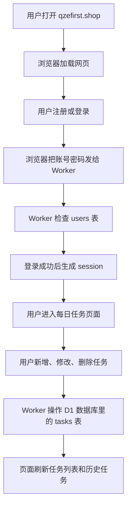
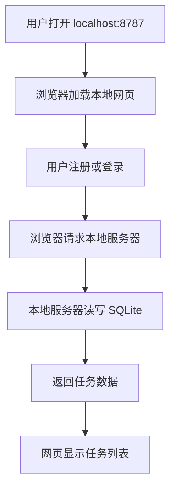

# 从零到当前网站完整操作流程

这份文档是把你从最开始想做第一个网站，到现在网站已经基本成型的全过程整理下来。

目标读者：刚开始学习网站制作的新手小白。

你现在做出来的网站已经不只是“显示几个字”的页面了，它已经逐步包含了：

- 自己购买的域名
- Cloudflare 托管和访问
- GitHub 代码仓库
- 每日任务 Todo List
- 云端数据库 Cloudflare D1
- 注册、登录
- 每个用户只能看到自己的任务
- 历史任务记录
- 本地数据库学习版

---

## 0. 先记住几个核心概念

在正式回顾流程之前，先把几个词说清楚。

### 0.1 网站是什么

网站本质上就是一堆文件和程序。

最简单的网站只有一个页面文件：

```text
index.html
```

浏览器打开这个文件，就可以显示网页内容。

如果只是显示文字，比如：

```text
qze的第一个网站
```

那它就是一个静态网站。

### 0.2 域名是什么

域名就是别人访问你网站时输入的网址名字。

你的域名是：

```text
qzefirst.shop
```

别人访问时可以输入：

```text
https://qzefirst.shop
```

域名本身不等于网站。

域名更像是“门牌号”。

网站代码和服务器才是真正的“房子”。

### 0.3 Cloudflare 是什么

Cloudflare 在你的项目里主要做了几件事：

```text
管理域名 DNS
托管网站
运行 Worker 后端程序
连接 D1 云端数据库
```

你可以把 Cloudflare 理解成：

```text
域名管理 + 网站服务器 + 云端数据库平台
```

### 0.4 GitHub 是什么

GitHub 是放代码的地方。

你的个人仓库是：

```text
git@github.com:quzhongen/xiaoqu.git
```

它的作用是保存网站代码，方便 Cloudflare 读取代码并部署。

### 0.5 数据库是什么

数据库就是保存数据的地方。

比如你的任务网站需要保存：

- 用户账号
- 用户密码的加密结果
- 登录状态
- 每个用户创建的任务
- 每个任务的状态
- 每个任务的开始时间
- 每个任务的结束时间
- 每个任务是否完成

这些都不能只放在页面里，否则刷新页面或者换电脑就没有了。

---

## 1. 第一阶段：最开始的目标

最开始你的目标很简单：

```text
做一个网站，别人输入网址就能访问，页面上显示“qze的第一个网站”
```

这个阶段的网站只需要三样东西：

```text
网页文件
托管平台
访问地址
```

最开始可以先不需要数据库，也不需要登录。

---

## 2. 第二阶段：购买域名

你后面购买了域名：

```text
qzefirst.shop
```

### 2.1 为什么要买域名

如果不买域名，Cloudflare 会给你一个默认地址，例如：

```text
qzefirst.pages.dev
```

或者：

```text
qzefirst-cloud.2752303458.workers.dev
```

这种地址也可以访问，但是不够像正式网站。

买了域名之后，你就可以用自己的地址：

```text
https://qzefirst.shop
```

### 2.2 买域名时需要填写什么

买域名一般会要求填写：

- 名字
- 姓氏
- 国家
- 城市
- 地址
- 邮箱
- 电话

这些是域名注册信息。

填写时要注意：

- 国家选择真实国家
- 城市填写所在城市
- 地址尽量按照“省/市/区/街道/门牌号”的方式写清楚
- 邮箱要能收到验证邮件
- 电话要能接收必要通知

### 2.3 域名买一年可以吗

可以。

域名通常可以按年购买。

你选择的是便宜的 `.shop` 域名，一年即可。

到期前如果还要继续使用，需要续费。

---

## 3. 第三阶段：把域名交给 Cloudflare 管理

买完域名后，域名默认由注册商管理。

你当时是在 Spaceship 里买的域名。

为了让 Cloudflare 管理这个域名，需要把域名的名称服务器改成 Cloudflare 提供的名称服务器。

### 3.1 什么是名称服务器

名称服务器英文叫：

```text
Nameserver
```

它的作用是告诉全世界：

```text
这个域名应该由谁来解析
```

简单理解：

```text
别人访问 qzefirst.shop
        ↓
先问 Nameserver
        ↓
Nameserver 告诉浏览器去哪里找网站
```

### 3.2 你当时需要改成的 Cloudflare Nameserver

Cloudflare 给你的名称服务器是：

```text
faye.ns.cloudflare.com
mack.ns.cloudflare.com
```

你需要在 Spaceship 后台把原来的：

```text
launch1.spaceship.net
launch2.spaceship.net
```

替换成：

```text
faye.ns.cloudflare.com
mack.ns.cloudflare.com
```

### 3.3 操作步骤

1. 打开 Spaceship 官网并登录。
2. 找到你的域名：

```text
qzefirst.shop
```

3. 进入 DNS 或 Nameserver 管理页面。
4. 选择自定义 Nameserver。
5. 删除 Spaceship 默认的 Nameserver。
6. 添加 Cloudflare 的两个 Nameserver：

```text
faye.ns.cloudflare.com
mack.ns.cloudflare.com
```

```text
faye.ns.cloudflare.com
mack.ns.cloudflare.com
```

7. 保存。
8. 回到 Cloudflare，等待状态变成正常。

### 3.4 为什么需要等待

DNS 修改不是立刻全世界生效。

它需要同步。

一般几分钟到几个小时。

有时 Cloudflare 页面会提示最长可能需要 48 小时。

---

## 4. 第四阶段：在 Cloudflare 创建第一个网站

域名准备好以后，就需要真正创建网站。

最开始的网站可以用 Cloudflare Pages。

### 4.1 Cloudflare Pages 是什么

Cloudflare Pages 适合放静态网站。

静态网站就是：

- HTML
- CSS
- JavaScript
- 图片

这种不需要复杂服务器的网站。

### 4.2 你当时看到的几个入口

Cloudflare 现在界面里有时候不是直接叫 Pages，而是合并到：

```text
Workers 和 Pages
```

创建时可能出现：

```text
Create Worker
Upload your static files
Want to deploy Pages? Start using it
```

如果你只是上传静态页面，可以选：

```text
Drag and drop files
```

或者：

```text
Upload your static files
```

### 4.3 第一个页面内容

最开始页面内容就是：

```text
qze的第一个网站
```

对应的 `index.html` 可以很简单：

```html
<!doctype html>
<html lang="zh-CN">
<head>
  <meta charset="UTF-8">
  <title>qze的第一个网站</title>
</head>
<body>
  <h1>qze的第一个网站</h1>
</body>
</html>
```

解释：

- `<!doctype html>`：告诉浏览器这是 HTML 页面。
- `<html lang="zh-CN">`：告诉浏览器页面语言是中文。
- `<head>`：放网页的设置。
- `<title>`：浏览器标签页上的标题。
- `<body>`：真正显示给用户看的内容。
- `<h1>`：大标题。

---

## 5. 第五阶段：理解几个网址的区别

你后来同时看到过几个网址。

这些网址看起来都是你的网站，但它们不完全一样。

### 5.1 `qzefirst.pages.dev`

这是 Cloudflare Pages 给你的默认测试地址。

类似：

```text
https://qzefirst.pages.dev
```

它通常对应你的 Pages 项目。

### 5.2 `qzefirst-cloud.2752303458.workers.dev`

这是 Cloudflare Worker 给你的默认地址。

类似：

```text
https://qzefirst-cloud.2752303458.workers.dev
```

它通常对应你的 Worker 后端项目。

### 5.3 `qzefirst.shop`

这是你自己买的正式域名。

```text
https://qzefirst.shop
```

这个地址最终可以绑定到 Pages，也可以绑定到 Worker。

### 5.4 为什么它们显示效果不一样

因为它们可能指向不同项目。

举个例子：

```text
qzefirst.pages.dev
        ↓
旧的静态 Pages 项目

qzefirst-cloud.2752303458.workers.dev
        ↓
新的 Worker + D1 项目

qzefirst.shop
        ↓
你后来绑定到哪个项目，它就显示哪个项目
```

所以它们不是“同一个网站的三个名字”那么简单。

它们更像：

```text
同一个人手里有几把钥匙，但可能开的是不同的门
```

---

## 6. 第六阶段：绑定自己的域名

你希望别人直接访问：

```text
https://qzefirst.shop
```

而不是访问 Cloudflare 默认地址。

这就需要绑定自定义域名。

### 6.1 Pages 绑定域名

如果是 Pages 项目，一般路径是：

```text
Workers 和 Pages
→ 选择你的 Pages 项目
→ 自定义域
→ 添加自定义域
```

然后输入：

```text
qzefirst.shop
```

Cloudflare 会自动帮你创建 DNS 记录。

### 6.2 Worker 绑定域名

如果是 Worker 项目，一般路径是：

```text
Workers 和 Pages
→ 选择 Worker 项目 qzefirst-cloud
→ 域
→ 自定义域和路由
→ 添加域名
```

然后输入：

```text
qzefirst.shop
```

### 6.3 添加域名还是添加路由

你当时问过：

```text
点击添加路由还是添加域名？
```

对于你的目标，应该点：

```text
添加域名
```

原因：

- 添加域名：让整个 `qzefirst.shop` 指向这个 Worker。
- 添加路由：更适合高级用法，比如只让某个路径走 Worker。

你的目标是整个网站都走 Worker，所以选择添加域名。

### 6.4 遇到 DNS 冲突怎么办

你当时遇到过错误：

```text
Hostname 'qzefirst.shop' already has externally managed DNS records
```

意思是：

```text
qzefirst.shop 已经有一条 DNS 记录被别的项目占用了
```

你当时 DNS 里有一条：

```text
qzefirst.shop CNAME qzefirst.pages.dev
```

这表示域名还指向旧的 Pages 项目。

解决方式：

1. 进入 Cloudflare。
2. 打开域名 `qzefirst.shop`。
3. 进入 DNS 记录。
4. 找到旧的 CNAME 记录：

```text
qzefirst.shop → qzefirst.pages.dev
```

5. 删除这条旧记录。
6. 回到 Worker 项目的“域”页面。
7. 再次点击“添加域名”。
8. 输入：

```text
qzefirst.shop
```

9. 等待添加成功。

---

## 7. 第七阶段：把代码放到 GitHub

当网站从简单页面变成完整项目后，需要用 GitHub 保存代码。

你的个人仓库是：

```text
git@github.com:quzhongen/xiaoqu.git
```

### 7.1 为什么要用 GitHub

GitHub 的作用：

- 保存代码
- 记录每一次修改
- 方便 Cloudflare 自动部署
- 换电脑也能拉取代码
- 代码不容易丢

### 7.2 基本流程

正常开发流程是：

```text
本地写代码
↓
git add
↓
git commit
↓
git push
↓
GitHub 收到代码
↓
Cloudflare 根据 GitHub 代码部署网站
```

### 7.3 常用 Git 命令

进入项目目录：

```bash
cd /c/Users/27523/Documents/wangzhan-test/xiaoqu-repo
```

查看当前改动：

```bash
git status
```

添加文件到暂存区：

```bash
git add .
```

提交一次修改：

```bash
git commit -m "描述这次修改做了什么"
```

推送到远程仓库：

```bash
git push
```

解释：

- `git status`：看看哪些文件变了。
- `git add .`：把当前文件改动准备提交。
- `git commit`：正式保存一个版本。
- `git push`：把本地版本上传到 GitHub。

---

## 8. 第八阶段：从简单网站升级成 Todo List

后来你提出新需求：

```text
网站标题还是 qze的第一个网站
大标题改成 每日任务
可以添加任务
可以删除任务
任务有状态
任务可以设置结束时间
任务到期后自动变成未完成
任务只能修改一次结束时间
```

### 8.1 页面结构

网站页面大概分成几块：

```text
左上角：qze的第一个网站
中间大标题：每日任务
输入区域：输入任务内容和结束时间
任务列表：显示所有任务
历史任务：显示所有创建过的任务记录
```

### 8.2 任务状态

任务状态分成四种：

```text
未开始
进行中
已完成
未完成
```

含义：

- 未开始：任务创建了，但还没开始做。
- 进行中：正在做。
- 已完成：已经做完了。
- 未完成：到结束时间还没完成，自动失败。

### 8.3 每个任务需要保存哪些信息

一个任务不是只有标题。

它至少需要保存：

```text
任务 ID
任务标题
任务状态
创建时间
结束时间
是否已经修改过结束时间
更新时间
属于哪个用户
```

如果写成数据库字段，大概是：

```text
id
owner_id
title
status
created_at
deadline_at
deadline_edited
updated_at
```

### 8.4 为什么需要任务 ID

因为用户可能创建多个同名任务。

比如：

```text
学习
学习
学习
```

如果只靠标题，程序不知道你要删除哪一个。

所以每个任务都需要一个唯一 ID。

---

## 9. 第九阶段：从浏览器本地存储升级到云端数据库

最开始 Todo List 可以直接存在浏览器里。

比如用：

```text
localStorage
```

但是这样有问题：

```text
换电脑后数据就没了
换浏览器后数据也没了
清理浏览器缓存后数据也可能没了
```

你后来想要的效果是：

```text
换台电脑，登录账号后，数据还在
```

这就需要云端数据库。

### 9.1 你选择的云端方案

你选择的是：

```text
Cloudflare D1 + Worker
```

### 9.2 这个方案的结构

线上结构是：

```text
浏览器
↓
Cloudflare Worker
↓
Cloudflare D1 数据库
```

解释：

- 浏览器：用户看到的网页。
- Worker：运行后端代码，处理注册、登录、任务增删改查。
- D1：保存真正的数据。

### 9.3 你的 D1 数据库

你创建的 D1 数据库名称是：

```text
qzefirst_todo
```

数据库 ID 是：

```text
eb8f7413-0c44-4d5a-892a-f00c7a55ef4c
```

### 9.4 D1 绑定变量

Worker 代码里不能凭空访问数据库。

需要在 Cloudflare 后台给 Worker 绑定 D1 数据库。

你使用的变量名是：

```text
DB
```

代码里通过：

```js
env.DB
```

访问 D1 数据库。

这里要特别注意：

```text
变量名必须叫 DB
```

如果后台绑定名不是 `DB`，代码就找不到数据库。

---

## 10. 第十阶段：创建数据库表

数据库不是创建好就能直接用。

数据库里面还需要建表。

表可以理解为 Excel 里的一个工作表。

你的项目需要三张核心表：

```text
users
sessions
tasks
```

### 10.1 users 表

作用：

```text
保存用户账号信息
```

字段大概是：

```text
id
username
username_normalized
password_salt
password_hash
created_at
updated_at
```

解释：

- `id`：用户唯一编号。
- `username`：用户输入的账号名。
- `username_normalized`：处理后的账号名，用来避免大小写重复。
- `password_salt`：密码盐。
- `password_hash`：密码加密后的结果。
- `created_at`：创建时间。
- `updated_at`：更新时间。

注意：

数据库里不应该保存明文密码。

正确做法是保存：

```text
密码盐 + 密码哈希
```

### 10.2 sessions 表

作用：

```text
保存登录状态
```

字段大概是：

```text
token_hash
user_id
created_at
expires_at
```

解释：

- `token_hash`：登录令牌的加密结果。
- `user_id`：这个登录状态属于哪个用户。
- `created_at`：登录状态创建时间。
- `expires_at`：登录状态过期时间。

### 10.3 tasks 表

作用：

```text
保存任务
```

字段大概是：

```text
id
owner_id
title
status
created_at
deadline_at
deadline_edited
updated_at
```

解释：

- `id`：任务唯一编号。
- `owner_id`：任务属于哪个用户。
- `title`：任务标题。
- `status`：任务状态。
- `created_at`：任务创建时间。
- `deadline_at`：任务结束时间。
- `deadline_edited`：是否已经修改过结束时间。
- `updated_at`：最后更新时间。

---

## 11. 第十一阶段：注册和登录功能

你后来提出：

```text
所有人都可以访问网站，但是需要登录
登录后只能看到自己的数据
换电脑登录后还能看到自己的任务
```

这就需要账号系统。

### 11.1 注册流程

用户注册时，流程是：

```text
用户输入账号和密码
↓
前端把账号密码发给后端
↓
后端检查账号是否已经存在
↓
后端给密码生成密码盐
↓
后端把密码加密成 hash
↓
后端把用户信息保存到 users 表
↓
后端生成登录 token
↓
浏览器保存 token
↓
用户进入任务页面
```

### 11.2 登录流程

用户登录时，流程是：

```text
用户输入账号和密码
↓
后端根据账号查找用户
↓
取出这个用户的 password_salt
↓
用用户输入的密码重新计算 password_hash
↓
和数据库里的 password_hash 比较
↓
一致就登录成功
↓
不一致就登录失败
```

### 11.3 为什么不用明文密码

不能这样保存：

```text
账号：quzhongen
密码：123456
```

因为如果数据库泄露，别人就能直接看到用户密码。

更安全的方式是保存：

```text
账号：quzhongen
密码盐：一串随机字符
密码哈希：一串加密结果
```

这样数据库里看不到真正密码。

---

## 12. 第十二阶段：每个用户的数据隔离

你的网站现在不是所有人共用一份任务列表。

而是：

```text
张三登录 → 看到张三自己的任务
李四登录 → 看到李四自己的任务
```

关键字段是：

```text
tasks.owner_id
```

每个任务都保存它属于哪个用户。

查询任务时，后端不能直接写：

```sql
SELECT * FROM tasks;
```

这样会查出所有人的任务。

正确写法是：

```sql
SELECT * FROM tasks WHERE owner_id = ?;
```

意思是：

```text
只查当前登录用户自己的任务
```

---

## 13. 第十三阶段：历史任务功能

你后来要求增加：

```text
历史任务
用户点击历史任务后可以看到自己所有创建的任务
显示创建日期和完成情况
按照日期时间排序
```

### 13.1 历史任务显示什么

历史任务至少显示：

```text
任务标题
创建日期
结束时间
完成情况
当前状态
```

### 13.2 排序规则

按照创建时间排序：

```sql
ORDER BY created_at DESC
```

意思是：

```text
最新创建的任务排在最前面
```

### 13.3 为什么删除任务后还要考虑历史

这里有两种产品设计：

第一种：

```text
删除任务 = 数据库彻底删除
历史任务里也看不到
```

第二种：

```text
删除任务 = 从当前任务列表隐藏
历史任务里仍然保留
```

目前你的功能更接近第一种。

以后如果你想保留完整历史，可以给 tasks 表增加字段：

```text
deleted_at
```

这样删除时不是真删，而是记录删除时间。

这种方式叫：

```text
软删除
```

---

## 14. 第十四阶段：线上部署 Worker

你后来的主要线上项目是：

```text
qzefirst-cloud
```

它是 Cloudflare Worker 项目。

### 14.1 线上访问地址

Cloudflare 默认 Worker 地址：

```text
https://qzefirst-cloud.2752303458.workers.dev
```

你的正式域名地址：

```text
https://qzefirst.shop
```

### 14.2 部署流程

整体部署流程是：

```text
本地修改代码
↓
提交到 GitHub
↓
Cloudflare 拉取 GitHub 代码
↓
Cloudflare 构建
↓
Cloudflare 部署 Worker
↓
访问 qzefirst.shop 测试
```

### 14.3 Cloudflare 里常看的几个页面

你经常会用到：

```text
Workers 和 Pages
→ qzefirst-cloud
→ 部署
```

这里看是否部署成功。

```text
Workers 和 Pages
→ qzefirst-cloud
→ 绑定
```

这里看 D1 数据库有没有绑定。

```text
Workers 和 Pages
→ qzefirst-cloud
→ 设置
```

这里看环境变量、构建配置等。

```text
Workers 和 Pages
→ qzefirst-cloud
→ 域
```

这里看自定义域名是否绑定。

---

## 15. 第十五阶段：你遇到过的重要问题和解决方式

### 15.1 找不到 Pages

Cloudflare 后台有时把 Pages 放在：

```text
Workers 和 Pages
```

如果看不到 Pages，可以从创建 Worker 页面底部找：

```text
Want to deploy Pages? Start using it
```

### 15.2 GitHub App 按钮点不了

你当时在 GitHub 授权 Cloudflare App 时遇到按钮点不了。

常见原因：

- 页面没有加载完
- 浏览器窗口太小
- GitHub 授权弹窗状态异常
- 当前仓库已经授权过

可以尝试：

- 刷新页面
- 换浏览器
- 重新进入 Cloudflare 连接 GitHub
- 在 GitHub Settings → Applications 里管理 Cloudflare App

### 15.3 Cloudflare 构建失败：Authentication error

你遇到过：

```text
Authentication error [code: 10000]
```

原因：

```text
Cloudflare API Token 权限不够
```

解决方式：

- 检查 Cloudflare 的 API Token。
- 确认它有部署 Worker / Pages 的权限。
- 不要把 token 写进公开代码仓库。

### 15.4 D1 变量名错误

你页面曾提示：

```text
Cloudflare 还没有绑定 D1 数据库，变量名必须叫 DB
```

原因：

```text
Worker 后台没有正确绑定 D1
或者绑定变量名不是 DB
```

解决方式：

```text
Workers 和 Pages
→ qzefirst-cloud
→ 绑定
→ 添加绑定
→ D1 数据库
→ 变量名填写 DB
→ 数据库选择 qzefirst_todo
```

### 15.5 注册失败：PBKDF2 次数太高

你后来注册一直失败。

最后从 Cloudflare 日志里看到错误：

```text
Pbkdf2 failed: iteration counts above 100000 are not supported (requested 120000)
```

意思是：

```text
Cloudflare 的 PBKDF2 加密最多支持 100000 次
代码里写了 120000 次
所以注册失败
```

解决方式：

把代码里的加密迭代次数从：

```js
120000
```

改成：

```js
100000
```

### 15.6 数据库文件打开是乱码

你本地看到 `.sqlite` 文件打开像乱码。

这是正常的。

原因：

```text
.sqlite 不是普通文本文件
它是二进制数据库文件
```

不能直接用记事本看。

正确查看方式：

- 用数据库工具查看
- 用 SQL 查询查看
- 导出成 `.sql` 或 `.csv` 文本文件查看

---

## 16. 第十六阶段：本地数据库学习版

后来你说：

```text
我现在需要的不是通过域名去访问，而是本地访问
我想手动搭建数据库
我想学习正规编程语言搭建本地数据库
```

所以我们又单独做了一个本地学习项目。

项目位置：

```text
C:\Users\27523\Documents\wangzhan-test\my-local-database-site
```

### 16.1 本地版结构

本地版结构是：

```text
浏览器
↓
本地服务器
↓
本地 SQLite 数据库
```

访问地址：

```text
http://localhost:8787
```

数据库文件：

```text
C:\Users\27523\Documents\wangzhan-test\my-local-database-site\data\todo.sqlite
```

### 16.2 本地版和线上版的区别

| 对比项 | 本地版 | 线上版 |
|---|---|---|
| 访问地址 | `http://localhost:8787` | `https://qzefirst.shop` |
| 数据库 | 本机 SQLite | Cloudflare D1 |
| 是否别人能访问 | 默认只有你电脑能访问 | 所有人都能访问 |
| 是否适合学习 | 很适合 | 更接近正式上线 |
| 是否换电脑还有数据 | 不会自动有 | 登录后可以有 |

### 16.3 本地项目里的重要文件

```text
my-local-database-site
├─ public
│  └─ index.html
├─ data
│  └─ todo.sqlite
├─ server.mjs
├─ server.py
├─ start-node.sh
└─ .vscode
   └─ launch.json
```

解释：

- `public/index.html`：前端页面。
- `data/todo.sqlite`：本地数据库文件。
- `server.mjs`：Node.js 后端版本。
- `server.py`：Python 后端版本。
- `start-node.sh`：用 Git Bash 启动 Node 版的脚本。
- `.vscode/launch.json`：用 VS Code 运行项目的配置。

---

## 17. 第十七阶段：用 Git Bash 启动本地网站

你希望用开发常用的方式，不想一直用 CMD。

所以推荐用 Git Bash。

### 17.1 打开 Git Bash

在桌面或文件夹里右键，选择：

```text
Git Bash Here
```

打开后会看到类似：

```bash
27523@qze MINGW64 ~/Desktop
$
```

这个 `$` 后面就是输入命令的地方。

### 17.2 进入项目目录

输入：

```bash
cd /c/Users/27523/Documents/wangzhan-test/my-local-database-site
```

解释：

- Windows 路径是 `C:\Users\...`
- Git Bash 里要写成 `/c/Users/...`
- `cd` 的意思是进入某个文件夹

### 17.3 启动 Node 版

输入：

```bash
./start-node.sh
```

解释：

- `./` 表示运行当前文件夹里的脚本。
- `start-node.sh` 是启动 Node 版服务器的脚本。

如果提示没有权限，先执行：

```bash
chmod +x start-node.sh
```

再执行：

```bash
./start-node.sh
```

### 17.4 启动成功后

浏览器打开：

```text
http://localhost:8787
```

如果能看到网页，就说明本地网站跑起来了。

### 17.5 停止服务器

回到 Git Bash 窗口，按：

```text
Ctrl + C
```

就可以停止服务器。

---

## 18. 第十八阶段：用 VS Code 启动本地网站

你也可以不用命令行，直接用 VS Code 启动。

### 18.1 打开项目文件夹

打开 VS Code。

选择：

```text
文件
→ 打开文件夹
```

选择：

```text
C:\Users\27523\Documents\wangzhan-test\my-local-database-site
```

### 18.2 打开运行和调试

左侧点击：

```text
运行和调试
```

或者使用快捷键：

```text
Ctrl + Shift + D
```

### 18.3 选择运行配置

你可以选择：

```text
运行本地数据库网站 Node 版 server.mjs
```

或者：

```text
运行本地数据库网站 Python 版 server.py
```

### 18.4 点击绿色运行按钮

点击绿色三角形按钮。

成功后，浏览器访问：

```text
http://localhost:8787
```

---

## 19. 第十九阶段：Node 版和 Python 版的区别

你现在有两份后端代码：

```text
server.mjs
server.py
```

它们做的事情差不多：

```text
接收浏览器请求
处理注册登录
连接 SQLite 数据库
增删改查任务
返回结果给前端
```

### 19.1 Node.js 版

文件：

```text
server.mjs
```

适合方向：

- 前端开发
- 全栈开发
- 和 Cloudflare Worker 更接近

因为 Cloudflare Worker 用的也是 JavaScript。

### 19.2 Python 版

文件：

```text
server.py
```

适合方向：

- 编程入门
- 数据处理
- 自动化脚本
- AI 相关学习

Python 语法相对更像英文，入门更舒服。

### 19.3 现在你更适合先学哪个

如果你目标是继续做网站，我建议路线是：

```text
先学 HTML / CSS / JavaScript
再学一点 Node.js
同时用 Python 帮你理解后端和数据库
```

也就是说：

```text
网站主线：JavaScript / Node.js
理解辅助：Python
```

---

## 20. 第二十阶段：现在你的技术栈

技术栈就是：

```text
为了做这个项目，用到的一整套技术工具组合
```

你的当前技术栈可以分为线上版和本地学习版。

### 20.1 线上网站技术栈

```text
域名：qzefirst.shop
域名注册商：Spaceship
DNS 管理：Cloudflare DNS
网站运行：Cloudflare Worker
云端数据库：Cloudflare D1
代码仓库：GitHub
编程语言：JavaScript
页面技术：HTML + CSS + JavaScript
部署方式：GitHub + Cloudflare 自动/手动部署
```

### 20.2 本地学习版技术栈

```text
运行环境：本地电脑 Windows
编辑器：Visual Studio Code
终端：Git Bash
后端语言 1：JavaScript / Node.js
后端语言 2：Python
本地数据库：SQLite
网页前端：HTML + CSS + JavaScript
本地访问地址：http://localhost:8787
```

---

## 21. 第二十一阶段：数据库里的增删改查

你问过：

```text
这些代码是不是等同于数据库里面的增删改查？
```

答案是：

```text
是的，大部分网站功能最后都会落到数据库的增删改查
```

### 21.1 增

新增用户：

```sql
INSERT INTO users (...)
VALUES (...);
```

新增任务：

```sql
INSERT INTO tasks (...)
VALUES (...);
```

### 21.2 查

查询用户：

```sql
SELECT * FROM users WHERE username_normalized = ?;
```

查询当前用户任务：

```sql
SELECT * FROM tasks WHERE owner_id = ?;
```

### 21.3 改

修改任务状态：

```sql
UPDATE tasks
SET status = ?
WHERE id = ? AND owner_id = ?;
```

修改任务结束时间：

```sql
UPDATE tasks
SET deadline_at = ?, deadline_edited = 1
WHERE id = ? AND owner_id = ?;
```

### 21.4 删

删除任务：

```sql
DELETE FROM tasks
WHERE id = ? AND owner_id = ?;
```

### 21.5 为什么很多地方都有 owner_id

因为要保证：

```text
用户只能操作自己的任务
不能删别人的任务
不能改别人的任务
不能看别人的任务
```

---

## 22. 第二十二阶段：你现在的网站整体运行原理

现在可以用一张流程图理解。



本地版类似，只是把 Cloudflare Worker 和 D1 换成本地：



---

## 23. 第二十三阶段：如果从零重新做一遍，完整顺序应该是这样

如果以后你要复盘，建议按这个顺序来。

### 23.1 网站上线版完整顺序

```text
第 1 步：确定网站目标
第 2 步：购买域名
第 3 步：把域名 Nameserver 改到 Cloudflare
第 4 步：等待 Cloudflare 激活域名
第 5 步：创建 GitHub 仓库
第 6 步：写最简单的 index.html
第 7 步：把代码推送到 GitHub
第 8 步：在 Cloudflare 创建 Pages 或 Worker 项目
第 9 步：部署第一个静态页面
第 10 步：绑定 qzefirst.shop 自定义域名
第 11 步：升级页面为 Todo List
第 12 步：创建 Cloudflare D1 数据库
第 13 步：在 D1 里创建 users、sessions、tasks 表
第 14 步：给 Worker 绑定 D1，变量名设置为 DB
第 15 步：实现注册登录接口
第 16 步：实现任务增删改查接口
第 17 步：实现历史任务接口
第 18 步：提交代码到 GitHub
第 19 步：Cloudflare 部署最新版本
第 20 步：打开 qzefirst.shop 测试
```

### 23.2 本地学习版完整顺序

```text
第 1 步：创建本地项目文件夹
第 2 步：创建 public/index.html
第 3 步：创建 server.mjs 或 server.py
第 4 步：启动本地服务器
第 5 步：打开 http://localhost:8787
第 6 步：让后端自动创建 data/todo.sqlite
第 7 步：创建 users、sessions、tasks 三张表
第 8 步：测试注册
第 9 步：测试登录
第 10 步：测试新增任务
第 11 步：测试修改任务状态
第 12 步：测试删除任务
第 13 步：测试历史任务
第 14 步：关闭服务器
第 15 步：重新启动服务器，确认数据还在
```

---

## 24. 第二十四阶段：现在已经完成了什么

目前你已经完成了很多从零到一的关键步骤。

### 24.1 域名方面

已经有：

```text
qzefirst.shop
```

### 24.2 托管方面

已经使用：

```text
Cloudflare
```

### 24.3 代码方面

已经有：

```text
GitHub 仓库 xiaoqu
```

### 24.4 数据库方面

已经学习并接触了两种数据库：

```text
Cloudflare D1
SQLite
```

### 24.5 功能方面

已经做到或接近做到：

```text
注册
登录
每日任务
任务状态
任务结束时间
任务历史
用户数据隔离
本地数据库运行
```

---

## 25. 第二十五阶段：下一步建议

你现在已经不是只会“做一个页面”的阶段了。

你现在其实已经接触到完整网站的核心结构：

```text
前端
后端
数据库
域名
部署
GitHub
```

下一步建议按这个顺序学：

### 25.1 第一阶段：先把页面看懂

重点学：

```text
HTML
CSS
JavaScript
```

目标：

```text
能看懂页面上每个按钮、输入框、标题是怎么来的
```

### 25.2 第二阶段：把接口看懂

重点学：

```text
GET
POST
PUT
DELETE
JSON
fetch
```

目标：

```text
知道前端是怎么和后端说话的
```

### 25.3 第三阶段：把数据库看懂

重点学：

```text
CREATE TABLE
INSERT
SELECT
UPDATE
DELETE
WHERE
ORDER BY
```

目标：

```text
知道任务和用户到底存在了哪里
```

### 25.4 第四阶段：把登录看懂

重点学：

```text
密码盐
密码哈希
session
token
cookie / localStorage
```

目标：

```text
知道为什么登录后网站知道你是谁
```

### 25.5 第五阶段：把部署看懂

重点学：

```text
Git
GitHub
Cloudflare Worker
Cloudflare D1
DNS
自定义域名
```

目标：

```text
知道本地代码是怎么变成别人能访问的网站的
```

---

## 26. 最后一张总览图

```mermaid
flowchart LR
  A["最初想法：显示 qze的第一个网站"] --> B["购买域名 qzefirst.shop"]
  B --> C["接入 Cloudflare DNS"]
  C --> D["创建 Cloudflare Pages 静态网站"]
  D --> E["绑定自定义域名"]
  E --> F["推送代码到 GitHub xiaoqu"]
  F --> G["升级 Todo List"]
  G --> H["接入 Cloudflare D1 云端数据库"]
  H --> I["加入注册登录"]
  I --> J["用户数据隔离"]
  J --> K["加入历史任务"]
  K --> L["搭建本地 SQLite 学习版"]
  L --> M["当前状态：已经具备完整网站雏形"]
```



---

## 27. 你现在应该怎么理解自己的项目

你现在这个项目可以这样理解：

```text
它已经不是一个单纯页面。
它是一个完整网站的雏形。
```

完整网站一般都包含：

```text
页面
接口
数据库
账号系统
部署平台
域名
代码仓库
```

而你现在已经把这些都接触了一遍。

接下来最重要的不是一下子学很多新东西。

而是反复把这几个问题想明白：

```text
页面从哪里来？
按钮点击后发生了什么？
数据保存在哪里？
用户登录后网站怎么知道他是谁？
本地代码怎么变成线上网站？
数据库为什么不能直接用记事本打开？
```

只要这几个问题慢慢清楚了，你对网站开发的整体理解就会越来越稳。

